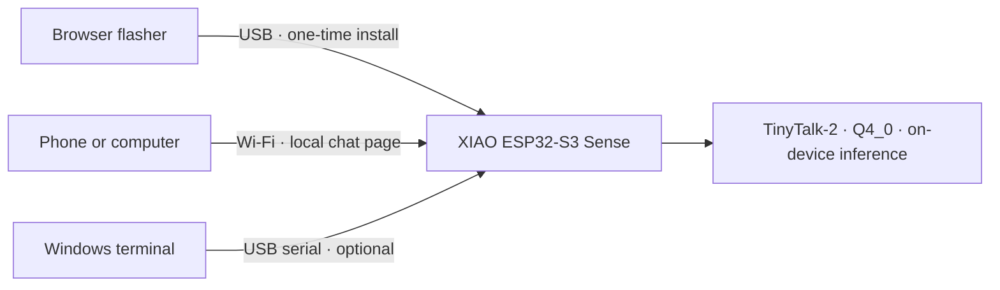

# TinyTalk XIAO

### A tiny offline chat model, running on your XIAO ESP32-S3 Sense.

Flash it once, connect to the board’s Wi-Fi, and chat with a model that runs on the microcontroller. The XIAO hosts the chat page itself: no cloud model, API key, phone app, or microSD card required.

[](https://vtrsharvin-sj.github.io/tinytalk-xiao/)
[](LICENSE)
[](#how-it-works)

> **Set expectations:** TinyTalk-2 is an 8M-parameter educational model for short conversation, tiny stories, and simple facts. It can lose the thread, go off-topic, or get answers wrong. This is a microcontroller demo, not a general-purpose assistant.

## Start chatting

### 1. Flash the board

1. Open the [TinyTalk XIAO web flasher](https://vtrsharvin-sj.github.io/tinytalk-xiao/) in desktop Chrome or Edge.
2. Connect a **Seeed Studio XIAO ESP32-S3 Sense** to your computer over USB.
3. Choose **Connect and flash** and select the XIAO’s USB serial device.
4. Wait for flashing to finish. The board reboots and starts its local Wi-Fi network.

### 2. Open the board chat

1. Join Wi-Fi **TinyTalk-XIAO**. The default password is **needlechat**.
2. Open **[http://192.168.4.1/](http://192.168.4.1/)** in a browser.
3. Type a short message and send it. Replies are generated on the XIAO.

The access point is local-only; it does not provide internet access. The password is a published default. Change it in [`firmware/main/main.cpp`](firmware/main/main.cpp) before sharing a customized build.

## USB terminal chat

The terminal client works without the display or Wi-Fi chat page.

**Windows quick start:** double-click [`legacy/Chat-TinyTalk2.bat`](legacy/Chat-TinyTalk2.bat), enter the XIAO’s COM port (usually `COM9`), then type at the `You >` prompt. The launcher clears old conversation history when it starts. Use `/new` to clear it again or `/quit` to exit.

Or run it directly:

```powershell
py -m pip install pyserial
py legacy/tinychat.py COM9
```

Close Arduino Serial Monitor, another terminal session, and any USB flasher first; Windows lets only one app use the COM port at a time. Replace `COM9` if your device uses a different port.

## How it works



The GitHub Pages site installs firmware. During chat, the browser talks directly to the XIAO over its local access point; the browser only displays the interface. The USB terminal is an alternate client. Both use the same model and share the board’s short in-memory conversation history.

## What’s on the board

| Component | Current build |
|---|---|
| Board | XIAO ESP32-S3 Sense · 8 MB flash · 8 MB PSRAM |
| Model | TinyTalk-2 · 8M parameters · Q4_0 weights embedded in firmware |
| Context | 72 tokens |
| Reply limit | Up to 24 generated tokens |
| Wi-Fi | Local access point: `TinyTalk-XIAO` |
| Chat address | `http://192.168.4.1/` |
| Inference | On the XIAO; no remote API or internet connection |

Short prompts fit this build best. On the connected board, short replies have measured around **2.7 tokens/second**; prompt processing and total wait vary with conversation length.

## Build from source

The model and tokenizer data are already included, so the firmware build does not download model weights. Install PlatformIO Core, then run:

```sh
pio run -e xiao_sense
```

The board configuration uses DIO flash mode. The web flasher downloads the prebuilt image at [`docs/firmware/factory.bin`](docs/firmware/factory.bin); its manifest is [`docs/firmware/manifest.json`](docs/firmware/manifest.json).

### Repository map

```text
docs/                   GitHub Pages flasher and factory firmware
firmware/main/           ESP-IDF application, inference code, model data
legacy/                  Windows BAT launcher and USB terminal client
platformio.ini           XIAO ESP32-S3 build target
LICENSE                 GPL-3.0-only license for project software
THIRD-PARTY-NOTICES.md   Model attribution and upstream license boundaries
```

## Troubleshooting

- **COM port access denied:** close Arduino Serial Monitor, another TinyTalk session, or a USB flasher, then retry.
- **Board Wi-Fi is missing:** reconnect the XIAO over USB and allow it to finish booting; then look for `TinyTalk-XIAO` again.
- **Chat page does not load:** connect to the XIAO’s Wi-Fi first, then open `http://192.168.4.1/`.
- **The answer is unrelated or incorrect:** the connection is working; that is a limitation of the tiny model. Try a shorter, simpler prompt or start a new conversation.
- **No display:** expected. The display is not needed for either browser chat or terminal chat.

## Licenses and attribution

Project-authored software is licensed under the **GNU General Public License v3.0 only (GPL-3.0-only)**; see [`LICENSE`](LICENSE). The project includes code adapted from [TheREZOR/cardputer-ai](https://github.com/TheREZOR/cardputer-ai); its upstream MIT notice is retained in [`THIRD-PARTY-NOTICES.md`](THIRD-PARTY-NOTICES.md).

The bundled **TinyTalk-2 model and associated training data** are attributed to [TheREZOR/TinyTalk-2](https://huggingface.co/TheREZOR/TinyTalk-2) and remain under **CC BY-NC-SA 4.0**. The model assets, including the data embedded in the firmware image, are not relicensed by this repository’s GPL license. The combined firmware distribution therefore includes separately licensed model assets with non-commercial terms. See [`THIRD-PARTY-NOTICES.md`](THIRD-PARTY-NOTICES.md) for details.

---

**Project:** [GitHub source](https://github.com/vtrsharvin-sj/tinytalk-xiao) · [Live flasher](https://vtrsharvin-sj.github.io/tinytalk-xiao/) · [TinyTalk-2 model card](https://huggingface.co/TheREZOR/TinyTalk-2)
